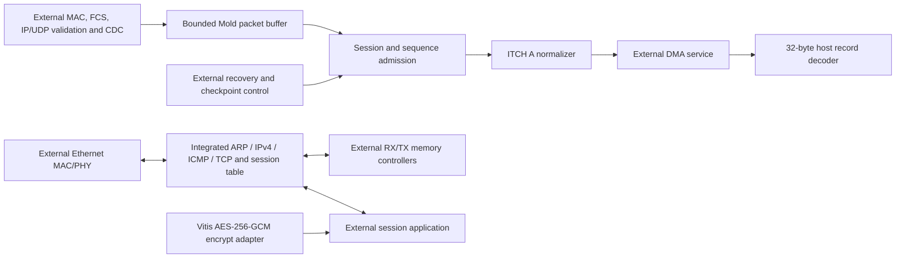
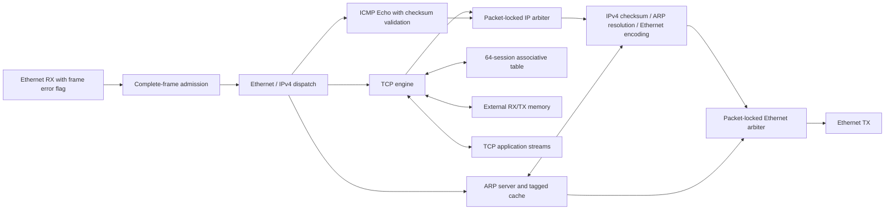

# FPGA integration components

This revision adds reusable components for a larger NIC/FPGA system. Source
dependencies were retrieved at immutable commits. **No build, application run,
simulation, lint, synthesis, formal proof or hardware validation was performed for
this revision**, as requested. The earlier results in FPGA_AUDIT.md apply only to
the earlier source state, not to these additions.

## Supplied components and external services



| Boundary | Implementation in this repository | Enclosing-system responsibility |
|---|---|---|
| Market data | `nexus_mold_ingress.sv`, bounded packet validation, session/sequence gate and ITCH A normalization | Ethernet/FCS, IP and UDP checksums, UDP payload extraction, feed serialization, buffering and packet-loss reporting |
| TCP/IP | `integration/nexus_tcp_ip_stack.cpp` connects Ethernet admission, ARP, IPv4, ICMP Echo, the ETH TCP engine and a 64-session table | MAC/PHY, RX/TX memory, TCP application and reset coordination |
| Encryption | `hls/security/nexus_aes256_gcm_encrypt.cpp` calls Vitis Security | Keys, unique IVs, record lengths, traffic policy and authenticated decryption if required |
| Host events | `hw/fpga_event.h` decodes a canonical record without allocation | DMA descriptors, completion ownership, memory mapping and driver-specific synchronization |
| Verification | Existing RTL regressions plus optional cocotb and SBY sources | Installing the selected toolchain and explicitly executing the prepared checks |

The old XOR `aes_gcm_offload`, stream-loopback `tcp_toe_wrapper` and constant-output
`tcp_rto_heap` have been removed. Their names are not retained as misleading
compatibility wrappers. `nexus_network_stack_top` remains a legacy loopback test
fixture; the reusable market-data entry point is **`nexus_mold_ingress`**.

## Integrated TCP/IP endpoint

**`src/nexus/fpga/integration/nexus_tcp_ip_stack.cpp` is the hardware HLS top**,
with its public contract in the adjacent `.hpp`. It connects actual protocol
implementations and owns the session lookup service; it is not a forwarding
placeholder. The tracked sources and pinned provider manifest are the source
deliverable. HLS-generated RTL and packaged IP have not been produced.



The endpoint uses a 64-bit stream and a 156.25 MHz clock, with MTU 1500 and up to
64 TCP sessions. It supports Ethernet II, IPv4 unicast, ARP requests/replies and
ICMP Echo requests. IPv6, VLANs, IPv4 options, fragmentation and UDP are rejected
at admission. This is an endpoint profile, not an IP router. The existing Mold
datapath still needs its own UDP provider; it is not connected to this TCP port.

The MAC strips preamble/FCS and reports any FCS/CDC/abort error through RX TUSER.
The integrated guard consumes through TLAST, rejects any marked frame and checks
KEEP/STRB, frame extent, supported protocol headers, IPv4 checksum, destination,
TTL, TCP header extent and ARP format before releasing bytes. Ethernet padding is
removed and unused output lanes are zero. TCP checksum/connection processing
belongs to the TOE; ICMP checksum validation precedes echo output. The guard
does not recompute Ethernet FCS. TX padding/FCS and physical link loss reporting
remain MAC responsibilities.

The receive guard has one 1514-byte frame bank and does not receive while replaying.
The ICMP path has bounded whole-packet buffering. These choices prevent malformed
headers or late error flags from corrupting stream state, but do not establish
continuous 10 Gb/s acceptance or a sub-microsecond latency bound. The MAC must
honour backpressure or buffer complete frames and explicitly report overflow.

The session table has 64 fixed slots indexed by session ID and compares the full
connection key. There is no probabilistic eviction. Pending updates take priority
over lookups, and a blocked update reply cannot be bypassed by a later lookup.
The enclosing application must obey session ownership and the TCP admission
protocol. RX/TX buffers retain the existing 16 MiB logical range per direction;
they are real memory interfaces, not successful-completion stubs.

Reset the top, memory services and application ownership together. Keep the MAC,
IPv4 address, netmask and gateway stable while active. Scalar MAC/IP settings use
the upstream lane-zero-first byte representation. The selected gateway must be
in the local subnet: upstream routes on-link traffic by comparing the destination
subnet with the gateway subnet. An ARP miss requests resolution and drops that
outgoing packet; TCP retransmission retries it. The ARP query interface can be
used to resolve a peer or gateway before opening a connection. ICMP Echo replies
are not queued indefinitely while ARP resolves.

The top and its exact source-preparation recipe are described in
[integration/README.md](src/nexus/fpga/integration/README.md). The recipe uses a
generated copy of the pinned provider and applies narrow compatibility/correctness
changes there; the dependency checkout remains unchanged. No bitstream or timing
result is implied by the source integration.

## Market-data interface

Input is a ready/valid 64-bit stream containing **one previously integrity-checked
UDP payload per frame**, byte zero in bits [7:0]. Non-final beats require `keep=ff`;
the final beat requires a contiguous nonempty low-byte mask. Neither the existing
metadata-only `hft_network_stack` nor a raw MAC stream satisfies this boundary.
All stages share one supplied clock. Connect real CDC before entering this domain.

The one-bit `s_axis_tuser` marks a bad frame. Any accepted beat with this flag
quarantines the entire packet until TLAST, then rejects it without order output.
Connect the Taxi CDC adapter's output error flag here: a unilateral source reset
can terminate a partially transmitted frame with an error marker. Never discard
that marker merely because the surviving bytes look like a valid Mold payload.

The default packet storage is 2048 bytes. The capacity parameter accepts multiples
of eight from 24 through 65528. The receiver drains oversized/malformed frames to
their accepted TLAST and publishes no order from them. A source must hold its
beat while ready is low; a physical Ethernet source requires an enclosing FIFO
and an explicit whole-packet overflow policy.

The packet buffer verifies the full 20-byte Mold header, count, message lengths,
all packet bytes, sequence arithmetic, and every supported Add Order's length,
side and nonzero quantity **before replay**. Consequently a malformed later Add
Order cannot allow an earlier Add Order in the same packet to escape validation.
Other message types are framed and skipped by the normalizer. This remains an
Add Order slice, not a complete ITCH book reconstruction engine. CME packet
deframing and all non-A ITCH semantics remain external/future components.

Storage is bounded and single-buffered. Replay assembles bytes from synchronous
RAM before emitting message beats; it intentionally does not overlap receipt of
the next packet. This implementation has **no line-rate or sub-microsecond latency
claim**. A higher-throughput shell may supply multiple independent packet banks,
but must retain the validation/admission ordering and measure the resulting design.
See [the packet/decoder contracts](docs/FPGA_MARKET_DATA.md).

### Sequence admission and recovery

After reset, `recovery_needed=1` and all packets are drained without order output.
The control plane arms a specific 80-bit session and 64-bit next sequence using
`cfg_valid/cfg_ready`. Configuration is accepted only when both packet processing
and normalized output are idle; it wins over a simultaneous new input beat.

For the configured session, a valid packet starting at `expected_sequence` is
admitted and advances that checkpoint by its message count. Counts include
unsupported and empty messages, not only emitted Add Orders. A wholly duplicated
packet is discarded without changing the checkpoint. Partially overlapping
packets are not trimmed: they require recovery from an exact checkpoint. The
sequence number never wraps within a session.

| `fault_code` | Meaning |
|---|---|
| 0 | Armed; no fault latched |
| 1 | No checkpoint installed after reset |
| 2 | Packet validation failed, including a sequence-overflow parser error |
| 3 | Session mismatch |
| 4 | Gap: packet starts after the expected sequence |
| 5 | Partial overlap across the checkpoint |
| 6 | Sequence overflow detected by the standalone admission gate |
| 7 | End-of-session control packet at the checkpoint |

A fault is sticky until an explicit new checkpoint. Heartbeats do not advance the
checkpoint; an ahead-of-checkpoint heartbeat reports a gap. Older heartbeat/end
markers are discarded. Duplicate suppression is useful for serialized A/B feeds,
but it is not an automatic redundant-feed selector or gap-retransmission client.
Do not directly connect the existing non-backpressured feed arbiter to this input.

Recovery must restore the book/snapshot and drain or invalidate outstanding DMA
records before rearming. Reset aborts in-flight packets and may truncate a record;
the external DMA engine must discard incomplete records, not publish completions
for them. `accepted_pulse` reports packet admission, not DMA completion or a
persistent recovery checkpoint. `decoder_reject` indicates a violated internal
decoder contract and must be escalated by the enclosing system.

## DMA record ABI

Each output frame is exactly four accepted 64-bit beats, with `keep=ff` and TLAST
on the fourth beat. Integer fields have little-endian serialization:

| Byte offset | Width | Field |
|---|---:|---|
| 0 | 8 | Exchange order ID |
| 8 | 8 | Timestamp; upper 16 bits zero |
| 16 | 4 | Price |
| 20 | 4 | Quantity |
| 24 | 2 | Stock locate |
| 26 | 1 | Side: 1 buy, 0 sell |
| 27 | 5 | Reserved, zero |

`m_order_session`, `m_order_sequence` and `m_order_packet_last` remain stable for
each record. A NIC may put them in its completion descriptor or a separate event
envelope; they are not silently inserted into the 32-byte record. Packet-last
marks a record only if the packet's final source message was an Add Order. It is
not an unconditional packet-completion marker.

`nexus::hw::decode_fpga_add_order` accepts a completed 32-byte CPU-readable buffer,
checks its fields and leaves the output unchanged on failure. It does not poll
MMIO or establish DMA coherence. Existing `MdAddOrder`/order-node sizes, queue
layout and release/acquire publication remain unchanged. The synthetic host
benchmark is not silently switched to a device source.

## External IP and source retrieval

[dependencies.lock.json](fpga/dependencies.lock.json) pins source commits and
records component licenses. [scripts/fpga_deps.py](scripts/fpga_deps.py) retrieves
source only into the ignored `.deps/fpga` cache, refuses modified/foreign existing
checkouts, and never installs drivers or runs upstream build scripts. Submodules
are not initialized automatically; optional platform references may require them
when an enclosing project chooses that platform.

| Profile | Dependencies | Integration status |
|---|---|---|
| `core` | ETH network stack, Taxi, Vitis Security | Integrated TCP/IP HLS top, crypto and Taxi CDC adapters; board services remain external |
| `dma` | LitePCIe | Pinned source provider for an external DMA shell; no generated PCIe core or driver installation |
| `nic_references` | Original Corundum, AMD OpenNIC | Alternative enclosing NICs; not combined into one datapath |
| `accelerators` | Coyote, Conifer, TreeLUT | Conifer source-export adapter; Coyote/TreeLUT remain optional platform references |

The core and DMA profiles and the Conifer source were fetched for this revision.
Source preparation is separate from execution. Examples for a later integration session:

```bash
python3 scripts/fpga_deps.py fetch --profile core --profile dma
python3 scripts/fpga_deps.py fetch --profile accelerators
python3 scripts/fpga_deps.py fetch --profile nic_references
```

[fpga/accelerators/export_conifer.py](fpga/accelerators/export_conifer.py) exports
a supplied, trusted XGBoost model to a fixed-point HLS source project using the
pinned Conifer API. It records the model hash, feature order, runtime versions,
precision and requested device/clock, and refuses an existing output directory.
It does not train a model, evaluate scores, compile code or run synthesis. See
[the accelerator contract](fpga/accelerators/README.md) for supported models,
finite-feature preconditions and numerical-validation requirements. No model was
exported during this revision.

Taxi is CERN-OHL-S-2.0 or commercial, not the MIT-licensed older
`verilog-ethernet`/`verilog-axis`. Original Corundum uses BSD-2-Clause-Views for its
core. Coyote's driver and Conifer's FPU have licenses separate from their main
repositories. Preserve upstream notices and review the licenses of selected files
when distributing a combined design; the lock file is not a replacement for them.

The concrete HLS and CDC interfaces, pinned upstream discrepancies and source
recipes are described in [integration/README.md](src/nexus/fpga/integration/README.md).
The upstream TCP shell's 24-bit connection reply conflicts with the HLS type's
72 semantic bits, so the adapter calls the typed engine directly. Its generated
IP metadata must define the actual synthesized port widths.

The TCP profile uses 64 sessions and a real 156.25 MHz clock: upstream timeout
constants assume 6.4 ns cycles. A tracked patch bounds the retransmit timer's
scan cursor after its five-entry hazard skip. The HLS recipe applies it to a
generated source copy after exact-context and revision checks, preserving the
upstream checkout. Neither this patch nor the profile has been synthesized here.

## Enclosing build integration

Source [fpga/market_data.tcl](fpga/market_data.tcl) from an existing Vivado project,
or register [nexus_market_data.core](nexus_market_data.core) with FuseSoC. Neither
entry point invents board pins, clocks, reset constraints or a deployable top.
UL3524 uses GTF transceivers and requires an actual board-specific MAC/PHY shell;
generic UltraScale+ support in an upstream project is insufficient.

`HFT_FPGA_TOOLING=ON` exposes explicit `fpga_sources`, `fpga_tcp_ip`, `fpga_cocotb`
and `fpga_formal` CMake targets, plus the `nexus_fpga_host` interface library. They are
not default build dependencies or automatic CTest jobs. Existing
`HFT_FPGA_TESTS=ON` also includes the prepared host event-decoder regression.

After an explicit future HLS export, source [fpga/tcp_ip_stack.tcl](fpga/tcp_ip_stack.tcl)
to register `nexus.local:hls:nexus_tcp_ip_stack:1.0` in the enclosing Vivado project.
The loader refuses a missing export. Use that export's `component.xml` for actual
port names and packing; no wrapper assumes ungenerated HLS RTL signal names.

The optional verification sources and commands are documented in
[docs/FPGA_VERIFICATION.md](docs/FPGA_VERIFICATION.md). No result from these new
checks is claimed. HLS IP export, timing closure, TCP interoperability, crypto
vectors, DMA ownership validation and physical-card measurements remain pending.
